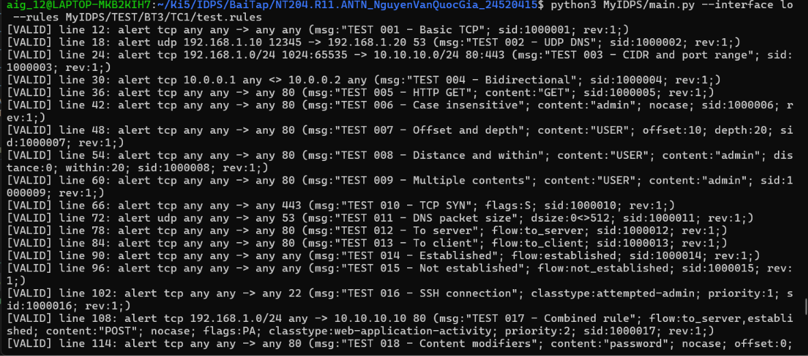

# Test case 1
> Nạp file có rule hợp lệ, comment và dòng trống. Kết quả mong đợi là chỉ rule hợp lệ được đưa sang parser 

Đầu tiên để test điều này, em thêm lệnh `print(f"[VALID] line {line_number}: {rule_text}")` vào `loader.py` sau khi verify rule như sau: 
```py
if result.valid and result.rule is not None:
    print(f"[VALID] line {line_number}: {rule_text}")
    rules.append(result.rule)
    continue
```

Em sử dụng `test1.rules`, là một file rule có các rule hợp lệ, comment và dòng trống để test chương trình có xem comment và dòng trống là rule không 

Kết quả: 


-> Các rule hợp lệ được in ra thành công, tức chương trình đánh giá nó hợp lệ, đồng thời không thấy comment và dòng trống được đánh giá là rule hợp lệ, tức test thành công 
