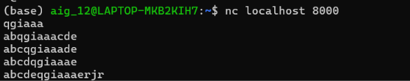

## Test Case 10 

> Option `offset` và `depth` hoạt động đúng 

Em sử dụng file `test10.rules` để test offset và depth, có nội dung sau: 
```
alert tcp 127.0.0.1 any -> 127.0.0.1 8000 (msg:"TEST offset and depth"; content:"qgiaaa"; offset:2; depth:8; sid:6000001; rev:1;)
```

-> Nó sẽ match với các packet có payload có string qgiaaa trong khoảng index `[2:9]`

Sau đó em dùng các packet với các payload tương ứng sau: 

- `qgiaaa`         -> qgiaaa trong index 0:5       
- `abqgiaaacde`    -> qgiaaa trong index 2:7       
- `abcqgiaaade`    -> qgiaaa trong index 3:8       
- `abcdqgiaaae`    -> qgiaaa trong index 4:9       
- `abcdeqgiaaaerjr`-> qgiaaa trong index 5:10      

Theo như mong muốn thì các payload thứ 2, 3, 4 sẽ match còn payload 1 và 5 sẽ không match 

Kết quả: 
```
{"event_type": "alert", "timestamp": "2026-11-06 15:02:10.078594", "packet_number": "669", "flow_id": "flow-000023", "rule": {"action": "alert", "protocol": "TCP", "msg": "TEST offset and depth", "sid": 6000001, "rev": 1, "flow": [], "content_count": 1, "raw": "alert tcp 127.0.0.1 any -> 127.0.0.1 8000 (msg:\"TEST offset and depth\"; content:\"qgiaaa\"; offset:2; depth:8; sid:6000001; rev:1;)", "line_number": 1}, "packet": {"number": "669", "timestamp": "2026-11-06 15:02:10.078594", "protocol": "TCP", "src_ip": "127.0.0.1", "dst_ip": "127.0.0.1", "src_port": 36962, "dst_port": 8000, "payload_length": 12, "dsize": 12, "tcp_flags": ["A", "P"], "flow_id": "flow-000023", "flow_direction": "to_server", "flow_flags": ["established", "to_server"]}, "match": {"protocol": "TCP", "direction": "to_server", "matched_contents": [{"content_index": 0, "offset": 2, "length": 6}], "payload_offset": 2, "dsize": 12, "tcp_flags": ["A", "P"], "flags": "AP", "matched_content": "qgiaaa"}}

{"event_type": "alert", "timestamp": "2026-11-06 15:02:23.007538", "packet_number": "985", "flow_id": "flow-000023", "rule": {"action": "alert", "protocol": "TCP", "msg": "TEST offset and depth", "sid": 6000001, "rev": 1, "flow": [], "content_count": 1, "raw": "alert tcp 127.0.0.1 any -> 127.0.0.1 8000 (msg:\"TEST offset and depth\"; content:\"qgiaaa\"; offset:2; depth:8; sid:6000001; rev:1;)", "line_number": 1}, "packet": {"number": "985", "timestamp": "2026-11-06 15:02:23.007538", "protocol": "TCP", "src_ip": "127.0.0.1", "dst_ip": "127.0.0.1", "src_port": 36962, "dst_port": 8000, "payload_length": 12, "dsize": 12, "tcp_flags": ["A", "P"], "flow_id": "flow-000023", "flow_direction": "to_server", "flow_flags": ["established", "to_server"]}, "match": {"protocol": "TCP", "direction": "to_server", "matched_contents": [{"content_index": 0, "offset": 3, "length": 6}], "payload_offset": 3, "dsize": 12, "tcp_flags": ["A", "P"], "flags": "AP", "matched_content": "qgiaaa"}}

{"event_type": "alert", "timestamp": "2026-11-06 15:02:45.468841", "packet_number": "1424", "flow_id": "flow-000023", "rule": {"action": "alert", "protocol": "TCP", "msg": "TEST offset and depth", "sid": 6000001, "rev": 1, "flow": [], "content_count": 1, "raw": "alert tcp 127.0.0.1 any -> 127.0.0.1 8000 (msg:\"TEST offset and depth\"; content:\"qgiaaa\"; offset:2; depth:8; sid:6000001; rev:1;)", "line_number": 1}, "packet": {"number": "1424", "timestamp": "2026-11-06 15:02:45.468841", "protocol": "TCP", "src_ip": "127.0.0.1", "dst_ip": "127.0.0.1", "src_port": 36962, "dst_port": 8000, "payload_length": 12, "dsize": 12, "tcp_flags": ["A", "P"], "flow_id": "flow-000023", "flow_direction": "to_server", "flow_flags": ["established", "to_server"]}, "match": {"protocol": "TCP", "direction": "to_server", "matched_contents": [{"content_index": 0, "offset": 4, "length": 6}], "payload_offset": 4, "dsize": 12, "tcp_flags": ["A", "P"], "flags": "AP", "matched_content": "qgiaaa"}}
```


Nhận xét: kết quả đúng như mong muốn, chỉ có 3 detection events được sinh ra vơi các offset match tương ứng là 2, 3, 4 
