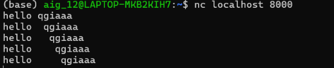

## Test Case 11 
> option `distance` và `within` hoạt động đúng 

Em sử dụng file `test11.rules` để test, có nội dung sau:
```
alert tcp 127.0.0.1 any -> 127.0.0.1 8000 (msg:"TEST distance and within"; content:"hello"; content:"qgiaaa"; distance:2; within:10; sid:6000001; rev:1;)
```

Rule này sẽ match với payload có `hello` và `qgiaaa` nằm trong offset [2-9] so với `hello`

Sau đó, em dùng các packets với các payloads sau để test 



- `hello qgiaaa`:      qgiaaa nằm trong offset [1:6] so với hello
- `hello  qgiaaa`:     qgiaaa nằm trong offset [2:7] so với hello
- `hello   qgiaaa`:    qgiaaa nằm trong offset [3:8] so với hello
- `hello    qgiaaa`:   qgiaaa nằm trong offset [4:9] so với hello
- `hello     qgiaaa`:  qgiaaa nằm trong offset [5:10] so với hello

Khi đó, kết quả ta mong muốn là chỉ có 3 payload 2, 3, 4 match; còn payloaod 1 và 5 sẽ không match  

Kết quả: 
```
{"event_type": "alert", "timestamp": "2026-11-06 15:18:04.402692", "packet_number": "536", "flow_id": "flow-000023", "rule": {"action": "alert", "protocol": "TCP", "msg": "TEST distance and within", "sid": 6000001, "rev": 1, "flow": [], "content_count": 2, "raw": "alert tcp 127.0.0.1 any -> 127.0.0.1 8000 (msg:\"TEST distance and within\"; content:\"hello\"; content:\"qgiaaa\"; distance:2; within:10; sid:6000001; rev:1;)", "line_number": 1}, "packet": {"number": "536", "timestamp": "2026-11-06 15:18:04.402692", "protocol": "TCP", "src_ip": "127.0.0.1", "dst_ip": "127.0.0.1", "src_port": 56216, "dst_port": 8000, "payload_length": 14, "dsize": 14, "tcp_flags": ["A", "P"], "flow_id": "flow-000023", "flow_direction": "to_server", "flow_flags": ["established", "to_server"]}, "match": {"protocol": "TCP", "direction": "to_server", "matched_contents": [{"content_index": 0, "offset": 0, "length": 5}, {"content_index": 1, "offset": 7, "length": 6}], "payload_offset": 0, "dsize": 14, "tcp_flags": ["A", "P"], "flags": "AP", "matched_content": ["hello", "qgiaaa"]}}

{"event_type": "alert", "timestamp": "2026-11-06 15:18:10.675433", "packet_number": "727", "flow_id": "flow-000023", "rule": {"action": "alert", "protocol": "TCP", "msg": "TEST distance and within", "sid": 6000001, "rev": 1, "flow": [], "content_count": 2, "raw": "alert tcp 127.0.0.1 any -> 127.0.0.1 8000 (msg:\"TEST distance and within\"; content:\"hello\"; content:\"qgiaaa\"; distance:2; within:10; sid:6000001; rev:1;)", "line_number": 1}, "packet": {"number": "727", "timestamp": "2026-11-06 15:18:10.675433", "protocol": "TCP", "src_ip": "127.0.0.1", "dst_ip": "127.0.0.1", "src_port": 56216, "dst_port": 8000, "payload_length": 15, "dsize": 15, "tcp_flags": ["A", "P"], "flow_id": "flow-000023", "flow_direction": "to_server", "flow_flags": ["established", "to_server"]}, "match": {"protocol": "TCP", "direction": "to_server", "matched_contents": [{"content_index": 0, "offset": 0, "length": 5}, {"content_index": 1, "offset": 8, "length": 6}], "payload_offset": 0, "dsize": 15, "tcp_flags": ["A", "P"], "flags": "AP", "matched_content": ["hello", "qgiaaa"]}}

{"event_type": "alert", "timestamp": "2026-11-06 15:18:18.354616", "packet_number": "949", "flow_id": "flow-000023", "rule": {"action": "alert", "protocol": "TCP", "msg": "TEST distance and within", "sid": 6000001, "rev": 1, "flow": [], "content_count": 2, "raw": "alert tcp 127.0.0.1 any -> 127.0.0.1 8000 (msg:\"TEST distance and within\"; content:\"hello\"; content:\"qgiaaa\"; distance:2; within:10; sid:6000001; rev:1;)", "line_number": 1}, "packet": {"number": "949", "timestamp": "2026-11-06 15:18:18.354616", "protocol": "TCP", "src_ip": "127.0.0.1", "dst_ip": "127.0.0.1", "src_port": 56216, "dst_port": 8000, "payload_length": 16, "dsize": 16, "tcp_flags": ["A", "P"], "flow_id": "flow-000023", "flow_direction": "to_server", "flow_flags": ["established", "to_server"]}, "match": {"protocol": "TCP", "direction": "to_server", "matched_contents": [{"content_index": 0, "offset": 0, "length": 5}, {"content_index": 1, "offset": 9, "length": 6}], "payload_offset": 0, "dsize": 16, "tcp_flags": ["A", "P"], "flags": "AP", "matched_content": ["hello", "qgiaaa"]}}

```


Nhận xét: có 3 detection events sinh ra đúng như mong muốn 
