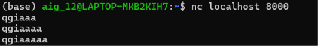

## Test Case 12 

> Option `flags` và `dsize` được xử lý đúng 

### Test `flags`
Em sử dụng `test12_1.rules` để test, có nội dung sau: 
```
# TEST 1 - Exact match: SYN only
alert tcp 127.0.0.1 any <> 127.0.0.1 80 (msg:"TEST 1"; flags:S; sid:6000001; rev:1;)
# TEST 2 - ! modifier: SYN must not be set
alert tcp 127.0.0.1 any <> 127.0.0.1 80 (msg:"TEST 2"; flags:!S; sid:6000004; rev:1;)
```

Sau đó em thực hiện kết nối đến localhost 80 bằng lệnh `nc localhost 80`

Kết quả 2 detection events sinh ra là: 
```
{"event_type": "alert", "timestamp": "2026-11-06 15:37:31.367237", "packet_number": "66", "flow_id": "flow-000023", "rule": {"action": "alert", "protocol": "TCP", "msg": "TEST 1", "sid": 6000001, "rev": 1, "flow": [], "flags": {"mode": "exact", "required": ["S"], "forbidden": []}, "content_count": 0, "raw": "alert tcp 127.0.0.1 any <> 127.0.0.1 80 (msg:\"TEST 1\"; flags:S; sid:6000001; rev:1;)", "line_number": 2}, "packet": {"number": "66", "timestamp": "2026-11-06 15:37:31.367237", "protocol": "TCP", "src_ip": "127.0.0.1", "dst_ip": "127.0.0.1", "src_port": 39714, "dst_port": 80, "payload_length": 0, "dsize": 0, "tcp_flags": ["S"], "flow_id": "flow-000023", "flow_direction": "to_server", "flow_flags": ["not_established", "to_server"]}, "match": {"protocol": "TCP", "direction": "to_server", "matched_contents": [], "dsize": 0, "tcp_flags": ["S"], "flags": "S"}}

{"event_type": "alert", "timestamp": "2026-11-06 15:37:31.367351", "packet_number": "68", "flow_id": "flow-000023", "rule": {"action": "alert", "protocol": "TCP", "msg": "TEST 2", "sid": 6000004, "rev": 1, "flow": [], "flags": {"mode": "excludes", "required": [], "forbidden": ["S"]}, "content_count": 0, "raw": "alert tcp 127.0.0.1 any <> 127.0.0.1 80 (msg:\"TEST 2\"; flags:!S; sid:6000004; rev:1;)", "line_number": 4}, "packet": {"number": "68", "timestamp": "2026-11-06 15:37:31.367351", "protocol": "TCP", "src_ip": "127.0.0.1", "dst_ip": "127.0.0.1", "src_port": 39714, "dst_port": 80, "payload_length": 0, "dsize": 0, "tcp_flags": ["A"], "flow_id": "flow-000023", "flow_direction": "to_server", "flow_flags": ["established", "to_server"]}, "match": {"protocol": "TCP", "direction": "to_server", "matched_contents": [], "dsize": 0, "tcp_flags": ["A"], "flags": "A"}}

```

Đúng như mong muốn: 
- rule 1 match với gói SYN, đúng với rule `flags:S` rằng chỉ có flag S 
- rule 2 match với gói ACK mà server trả về, đúng với rule `flags:!S` rằng không được có `S`


### Test `dsize`
Em sử dụng `test12_2.rules` để test, có nội dung sau: 
```
alert tcp 127.0.0.1 any -> 127.0.0.1 8000 (msg:"TEST dsize"; dsize:>=8; sid:6000001; rev:1;)
```

Sau đó em gửi đi các payload lần lượt là `qgiaaa`, `qgiaaaa`, `qgiaaaaa` với dsize tương ứng lần lượt là 7, 8, 9(chú ý size của payload tính thêm cả ký tự `\n` cuối cùng)




Kết quả:
```
{"event_type": "alert", "timestamp": "2026-11-06 15:42:14.205923", "packet_number": "175", "flow_id": "flow-000023", "rule": {"action": "alert", "protocol": "TCP", "msg": "TEST dsize", "sid": 6000001, "rev": 1, "flow": [], "dsize": {"operator": "ge", "value": 8}, "content_count": 0, "raw": "alert tcp 127.0.0.1 any -> 127.0.0.1 8000 (msg:\"TEST dsize\"; dsize:>=8; sid:6000001; rev:1;)", "line_number": 1}, "packet": {"number": "175", "timestamp": "2026-11-06 15:42:14.205923", "protocol": "TCP", "src_ip": "127.0.0.1", "dst_ip": "127.0.0.1", "src_port": 50046, "dst_port": 8000, "payload_length": 8, "dsize": 8, "tcp_flags": ["A", "P"], "flow_id": "flow-000023", "flow_direction": "to_server", "flow_flags": ["established", "to_server"]}, "match": {"protocol": "TCP", "direction": "to_server", "matched_contents": [], "dsize": 8, "tcp_flags": ["A", "P"], "flags": "AP"}}

{"event_type": "alert", "timestamp": "2026-11-06 15:42:16.556126", "packet_number": "209", "flow_id": "flow-000023", "rule": {"action": "alert", "protocol": "TCP", "msg": "TEST dsize", "sid": 6000001, "rev": 1, "flow": [], "dsize": {"operator": "ge", "value": 8}, "content_count": 0, "raw": "alert tcp 127.0.0.1 any -> 127.0.0.1 8000 (msg:\"TEST dsize\"; dsize:>=8; sid:6000001; rev:1;)", "line_number": 1}, "packet": {"number": "209", "timestamp": "2026-11-06 15:42:16.556126", "protocol": "TCP", "src_ip": "127.0.0.1", "dst_ip": "127.0.0.1", "src_port": 50046, "dst_port": 8000, "payload_length": 9, "dsize": 9, "tcp_flags": ["A", "P"], "flow_id": "flow-000023", "flow_direction": "to_server", "flow_flags": ["established", "to_server"]}, "match": {"protocol": "TCP", "direction": "to_server", "matched_contents": [], "dsize": 9, "tcp_flags": ["A", "P"], "flags": "AP"}}

```

Nhận xét: kết quả đúng như mong muốn, chỉ có 2 payload cuối match với rule, rule cũng chỉ ra match content là dsize 8 và 9 
