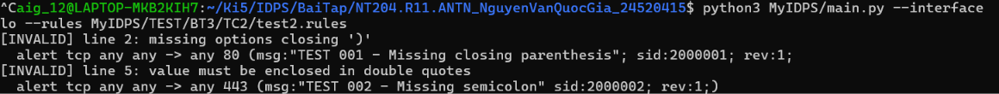
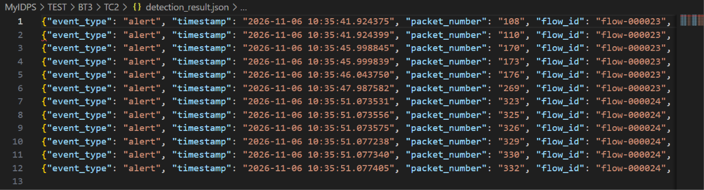

## Test case 2 
> Rule sai cú pháp được đánh dấu là invalid, có lý do và chương trình vẫn tiếp tục chạy 

Em sử dụng `test2.rules` có nội dung như sau để test:
```
# Thiếu ) kết thúc option 
alert tcp any any -> any 80 (msg:"TEST 001 - Missing closing parenthesis"; sid:2000001; rev:1; 

# Thiếu ; giữa các option 
alert tcp any any -> any 443 (msg:"TEST 002 - Missing semicolon" sid:2000002; rev:1;)

# Hợp lệ 
alert tcp any any -> any 80 (msg:"Match HTTP packets"; sid:2000001; rev:1;)
```
- Rule 1 và 2 invalid 
- Rule 3 valid 

Kết quả khi sử dụng rule này như sau: 
- Chương trình in ra 2 rule đầu tiên với đánh dấu invalid, kèm lý do 

    - rule 1: thiếu `)`, đúng với nguyên nhân 
    - rule 2: chương trình đánh giá lý do invalid là `value phải được đóng trong ""`, vì khi nguyên nhân chính là thiếu `;`, chương trình parse theo `;` sẽ lấy `"TEST 002 - Missing semicolon" sid:2000002` làm value của `msg` nhưng nó không được kết thúc bằng `"` nên chương trình lấy lý do là `value phải được đóng trong ""`
- Đồng thời, chương trình vẫn chạy tiếp tục, các packet match rule 3 vẫn sinh ra detection event ghi trong `detection_result.json` sau khi em thực hiện kết nối port 80 đến localhost đúng như rule 
