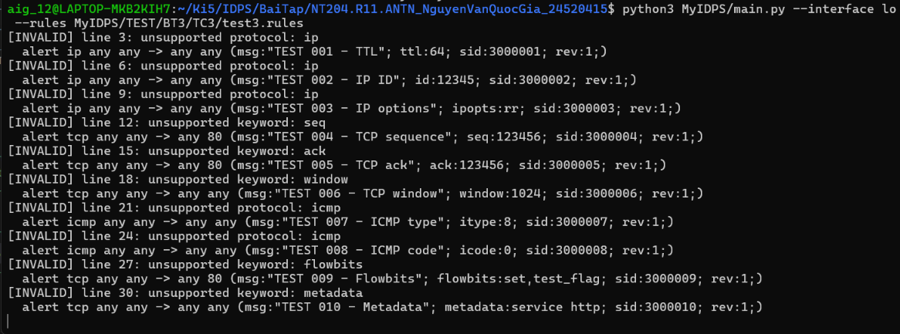
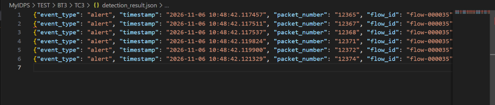

## Test Case 3 
> Rule dùng keyword ngoài phạm vi được đánh dấu là unspported, không crash 

Em sử dụng `test3.rules` có 10 rule sử dụng các keywork ngoài phạm vi để test, có nội dung như sau: 
```

# 001 - TTL
alert ip any any -> any any (msg:"TEST 001 - TTL"; ttl:64; sid:3000001; rev:1;)

# 002 - IP ID
alert ip any any -> any any (msg:"TEST 002 - IP ID"; id:12345; sid:3000002; rev:1;)

# 003 - IP options
alert ip any any -> any any (msg:"TEST 003 - IP options"; ipopts:rr; sid:3000003; rev:1;)

# 004 - TCP sequence number
alert tcp any any -> any 80 (msg:"TEST 004 - TCP sequence"; seq:123456; sid:3000004; rev:1;)

# 005 - TCP acknowledgment number
alert tcp any any -> any 80 (msg:"TEST 005 - TCP ack"; ack:123456; sid:3000005; rev:1;)

# 006 - TCP window size
alert tcp any any -> any any (msg:"TEST 006 - TCP window"; window:1024; sid:3000006; rev:1;)

# 007 - ICMP type
alert icmp any any -> any any (msg:"TEST 007 - ICMP type"; itype:8; sid:3000007; rev:1;)

# 008 - ICMP code
alert icmp any any -> any any (msg:"TEST 008 - ICMP code"; icode:0; sid:3000008; rev:1;)

# 009 - Flowbits
alert tcp any any -> any 80 (msg:"TEST 009 - Flowbits"; flowbits:set,test_flag; sid:3000009; rev:1;)

# 010 - Metadata
alert tcp any any -> any any (msg:"TEST 010 - Metadata"; metadata:service http; sid:3000010; rev:1;)

# valid 
alert tcp any any -> any 80 (msg:"Match HTTP packets"; sid:2000001; rev:1;)
```

Trong đó có rule cuối cùng là rule valid để test rằng chương trình không crash 

Kết quả: 

- Ta thấy được các rule sử dụng keyword ngoài phạm vi đó được đánh dấu là invalid với lý do là unsupported keyword tương ứng 
- Đồng thời thì chương trình cũng chạy ổn định, không crash, vẫn sinh ra detection event match với rule cuối đó 

