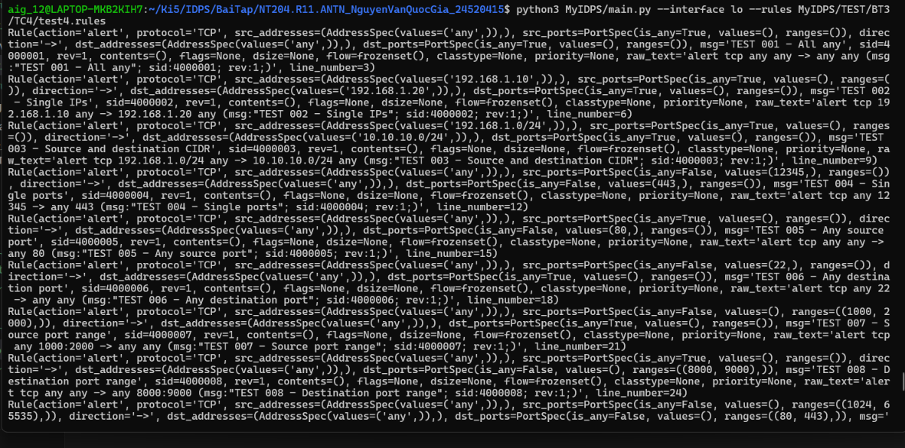

## Test case 4 
> Parse header TCP + any/single IP/CIDR + port range, kết quả yêu cầu là internal rule object đúng với rule đó 


Để test chức năng này, em sẽ thêm lệnh in ra object rule `print(result.rule)` sau khi verify rule trong `loader.py` như sau: 
```py
if result.valid and result.rule is not None:
    print(result.rule)
    rules.append(result.rule)
    continue
```

Em sử dụng `test4.rules` để test, nội dung là các rule chỉ có header, với các field port và ip đa dạng từ `any`, `single`, `range` trong port, `CIDR` và `single` trong IP 
```


# 001 - All any
alert tcp any any -> any any (msg:"TEST 001 - All any"; sid:4000001; rev:1;)

# 002 - Single source IP, single destination IP
alert tcp 192.168.1.10 any -> 192.168.1.20 any (msg:"TEST 002 - Single IPs"; sid:4000002; rev:1;)

# 003 - Source and destination CIDR
alert tcp 192.168.1.0/24 any -> 10.10.10.0/24 any (msg:"TEST 003 - Source and destination CIDR"; sid:4000003; rev:1;)

# 004 - Single source port, single destination port
alert tcp any 12345 -> any 443 (msg:"TEST 004 - Single ports"; sid:4000004; rev:1;)

# 005 - Any source port, single destination port
alert tcp any any -> any 80 (msg:"TEST 005 - Any source port"; sid:4000005; rev:1;)

# 006 - Single source port, any destination port
alert tcp any 22 -> any any (msg:"TEST 006 - Any destination port"; sid:4000006; rev:1;)

# 007 - Source port range
alert tcp any 1000:2000 -> any any (msg:"TEST 007 - Source port range"; sid:4000007; rev:1;)

# 008 - Destination port range
alert tcp any any -> any 8000:9000 (msg:"TEST 008 - Destination port range"; sid:4000008; rev:1;)

# 009 - Source and destination port ranges
alert tcp any 1024:65535 -> any 80:443 (msg:"TEST 009 - Both port ranges"; sid:4000009; rev:1;)

# 010 - Single IP with CIDR destination
alert tcp 192.168.1.100 any -> 10.10.10.0/24 80 (msg:"TEST 010 - Single IP and CIDR"; sid:4000010; rev:1;)

# 011 - CIDR source with single IP destination
alert tcp 172.16.0.0/16 any -> 192.168.1.50 443 (msg:"TEST 011 - CIDR and single IP"; sid:4000011; rev:1;)

# 012 - Bidirectional traffic
alert tcp 192.168.1.10 any <> 192.168.1.20 any (msg:"TEST 012 - Bidirectional traffic"; sid:4000012; rev:1;)

# 013 - Bidirectional with port ranges
alert tcp 10.0.0.0/8 1000:2000 <> 172.16.0.0/16 3000:4000 (msg:"TEST 013 - Bidirectional port ranges"; sid:4000013; rev:1;)

# 014 - UDP with single ports
alert udp 192.168.1.10 53000 -> 8.8.8.8 53 (msg:"TEST 014 - UDP single ports"; sid:4000014; rev:1;)

# 015 - UDP with any ports
alert udp any any -> any any (msg:"TEST 015 - UDP any ports"; sid:4000015; rev:1;)

# 016 - UDP with CIDR and port range
alert udp 10.10.0.0/16 1024:65535 -> 192.168.1.0/24 53 (msg:"TEST 016 - UDP CIDR and port range"; sid:4000016; rev:1;)

# 017 - TCP with single IP and port range
alert tcp 10.10.10.10 8080:8090 -> 192.168.1.100 443 (msg:"TEST 017 - TCP single IP and port range"; sid:4000017; rev:1;)

# 018 - IPv4 with any protocol-specific ports
alert ip 192.168.1.0/24 any -> 10.0.0.0/8 any (msg:"TEST 018 - IP protocol"; sid:4000018; rev:1;)

# 019 - ICMP with any addresses
alert icmp any any -> any any (msg:"TEST 019 - ICMP any addresses"; sid:4000019; rev:1;)

# 020 - Mixed CIDR and single ports
alert tcp 192.168.0.0/16 22 -> 10.10.10.10 8080 (msg:"TEST 020 - Mixed CIDR and single ports"; sid:4000020; rev:1;)

```

Kết quả: 


```
Rule(action='alert', protocol='TCP', src_addresses=(AddressSpec(values=('any',)),), src_ports=PortSpec(is_any=True, values=(), ranges=()), direction='->', dst_addresses=(AddressSpec(values=('any',)),), dst_ports=PortSpec(is_any=True, values=(), ranges=()), msg='TEST 001 - All any', sid=4000001, rev=1, contents=(), flags=None, dsize=None, flow=frozenset(), classtype=None, priority=None, raw_text='alert tcp any any -> any any (msg:"TEST 001 - All any"; sid:4000001; rev:1;)', line_number=3)
Rule(action='alert', protocol='TCP', src_addresses=(AddressSpec(values=('192.168.1.10',)),), src_ports=PortSpec(is_any=True, values=(), ranges=()), direction='->', dst_addresses=(AddressSpec(values=('192.168.1.20',)),), dst_ports=PortSpec(is_any=True, values=(), ranges=()), msg='TEST 002 - Single IPs', sid=4000002, rev=1, contents=(), flags=None, dsize=None, flow=frozenset(), classtype=None, priority=None, raw_text='alert tcp 192.168.1.10 any -> 192.168.1.20 any (msg:"TEST 002 - Single IPs"; sid:4000002; rev:1;)', line_number=6)
Rule(action='alert', protocol='TCP', src_addresses=(AddressSpec(values=('192.168.1.0/24',)),), src_ports=PortSpec(is_any=True, values=(), ranges=()), direction='->', dst_addresses=(AddressSpec(values=('10.10.10.0/24',)),), dst_ports=PortSpec(is_any=True, values=(), ranges=()), msg='TEST 003 - Source and destination CIDR', sid=4000003, rev=1, contents=(), flags=None, dsize=None, flow=frozenset(), classtype=None, priority=None, raw_text='alert tcp 192.168.1.0/24 any -> 10.10.10.0/24 any (msg:"TEST 003 - Source and destination CIDR"; sid:4000003; rev:1;)', line_number=9)
Rule(action='alert', protocol='TCP', src_addresses=(AddressSpec(values=('any',)),), src_ports=PortSpec(is_any=False, values=(12345,), ranges=()), direction='->', dst_addresses=(AddressSpec(values=('any',)),), dst_ports=PortSpec(is_any=False, values=(443,), ranges=()), msg='TEST 004 - Single ports', sid=4000004, rev=1, contents=(), flags=None, dsize=None, flow=frozenset(), classtype=None, priority=None, raw_text='alert tcp any 12345 -> any 443 (msg:"TEST 004 - Single ports"; sid:4000004; rev:1;)', line_number=12)
Rule(action='alert', protocol='TCP', src_addresses=(AddressSpec(values=('any',)),), src_ports=PortSpec(is_any=True, values=(), ranges=()), direction='->', dst_addresses=(AddressSpec(values=('any',)),), dst_ports=PortSpec(is_any=False, values=(80,), ranges=()), msg='TEST 005 - Any source port', sid=4000005, rev=1, contents=(), flags=None, dsize=None, flow=frozenset(), classtype=None, priority=None, raw_text='alert tcp any any -> any 80 (msg:"TEST 005 - Any source port"; sid:4000005; rev:1;)', line_number=15)
Rule(action='alert', protocol='TCP', src_addresses=(AddressSpec(values=('any',)),), src_ports=PortSpec(is_any=False, values=(22,), ranges=()), direction='->', dst_addresses=(AddressSpec(values=('any',)),), dst_ports=PortSpec(is_any=True, values=(), ranges=()), msg='TEST 006 - Any destination port', sid=4000006, rev=1, contents=(), flags=None, dsize=None, flow=frozenset(), classtype=None, priority=None, raw_text='alert tcp any 22 -> any any (msg:"TEST 006 - Any destination port"; sid:4000006; rev:1;)', line_number=18)
Rule(action='alert', protocol='TCP', src_addresses=(AddressSpec(values=('any',)),), src_ports=PortSpec(is_any=False, values=(), ranges=((1000, 2000),)), direction='->', dst_addresses=(AddressSpec(values=('any',)),), dst_ports=PortSpec(is_any=True, values=(), ranges=()), msg='TEST 007 - Source port range', sid=4000007, rev=1, contents=(), flags=None, dsize=None, flow=frozenset(), classtype=None, priority=None, raw_text='alert tcp any 1000:2000 -> any any (msg:"TEST 007 - Source port range"; sid:4000007; rev:1;)', line_number=21)
Rule(action='alert', protocol='TCP', src_addresses=(AddressSpec(values=('any',)),), src_ports=PortSpec(is_any=True, values=(), ranges=()), direction='->', dst_addresses=(AddressSpec(values=('any',)),), dst_ports=PortSpec(is_any=False, values=(), ranges=((8000, 9000),)), msg='TEST 008 - Destination port range', sid=4000008, rev=1, contents=(), flags=None, dsize=None, flow=frozenset(), classtype=None, priority=None, raw_text='alert tcp any any -> any 8000:9000 (msg:"TEST 008 - Destination port range"; sid:4000008; rev:1;)', line_number=24)
Rule(action='alert', protocol='TCP', src_addresses=(AddressSpec(values=('any',)),), src_ports=PortSpec(is_any=False, values=(), ranges=((1024, 65535),)), direction='->', dst_addresses=(AddressSpec(values=('any',)),), dst_ports=PortSpec(is_any=False, values=(), ranges=((80, 443),)), msg='TEST 009 - Both port ranges', sid=4000009, rev=1, contents=(), flags=None, dsize=None, flow=frozenset(), classtype=None, priority=None, raw_text='alert tcp any 1024:65535 -> any 80:443 (msg:"TEST 009 - Both port ranges"; sid:4000009; rev:1;)', line_number=27)
Rule(action='alert', protocol='TCP', src_addresses=(AddressSpec(values=('192.168.1.100',)),), src_ports=PortSpec(is_any=True, values=(), ranges=()), direction='->', dst_addresses=(AddressSpec(values=('10.10.10.0/24',)),), dst_ports=PortSpec(is_any=False, values=(80,), ranges=()), msg='TEST 010 - Single IP and CIDR', sid=4000010, rev=1, contents=(), flags=None, dsize=None, flow=frozenset(), classtype=None, priority=None, raw_text='alert tcp 192.168.1.100 any -> 10.10.10.0/24 80 (msg:"TEST 010 - Single IP and CIDR"; sid:4000010; rev:1;)', line_number=30)
Rule(action='alert', protocol='TCP', src_addresses=(AddressSpec(values=('172.16.0.0/16',)),), src_ports=PortSpec(is_any=True, values=(), ranges=()), direction='->', dst_addresses=(AddressSpec(values=('192.168.1.50',)),), dst_ports=PortSpec(is_any=False, values=(443,), ranges=()), msg='TEST 011 - CIDR and single IP', sid=4000011, rev=1, contents=(), flags=None, dsize=None, flow=frozenset(), classtype=None, priority=None, raw_text='alert tcp 172.16.0.0/16 any -> 192.168.1.50 443 (msg:"TEST 011 - CIDR and single IP"; sid:4000011; rev:1;)', line_number=33)
Rule(action='alert', protocol='TCP', src_addresses=(AddressSpec(values=('192.168.1.10',)),), src_ports=PortSpec(is_any=True, values=(), ranges=()), direction='<>', dst_addresses=(AddressSpec(values=('192.168.1.20',)),), dst_ports=PortSpec(is_any=True, values=(), ranges=()), msg='TEST 012 - Bidirectional traffic', sid=4000012, rev=1, contents=(), flags=None, dsize=None, flow=frozenset(), classtype=None, priority=None, raw_text='alert tcp 192.168.1.10 any <> 192.168.1.20 any (msg:"TEST 012 - Bidirectional traffic"; sid:4000012; rev:1;)', line_number=36)
Rule(action='alert', protocol='TCP', src_addresses=(AddressSpec(values=('10.0.0.0/8',)),), src_ports=PortSpec(is_any=False, values=(), ranges=((1000, 2000),)), direction='<>', dst_addresses=(AddressSpec(values=('172.16.0.0/16',)),), dst_ports=PortSpec(is_any=False, values=(), ranges=((3000, 4000),)), msg='TEST 013 - Bidirectional port ranges', sid=4000013, rev=1, contents=(), flags=None, dsize=None, flow=frozenset(), classtype=None, priority=None, raw_text='alert tcp 10.0.0.0/8 1000:2000 <> 172.16.0.0/16 3000:4000 (msg:"TEST 013 - Bidirectional port ranges"; sid:4000013; rev:1;)', line_number=39)
Rule(action='alert', protocol='UDP', src_addresses=(AddressSpec(values=('192.168.1.10',)),), src_ports=PortSpec(is_any=False, values=(53000,), ranges=()), direction='->', dst_addresses=(AddressSpec(values=('8.8.8.8',)),), dst_ports=PortSpec(is_any=False, values=(53,), ranges=()), msg='TEST 014 - UDP single ports', sid=4000014, rev=1, contents=(), flags=None, dsize=None, flow=frozenset(), classtype=None, priority=None, raw_text='alert udp 192.168.1.10 53000 -> 8.8.8.8 53 (msg:"TEST 014 - UDP single ports"; sid:4000014; rev:1;)', line_number=42)
Rule(action='alert', protocol='UDP', src_addresses=(AddressSpec(values=('any',)),), src_ports=PortSpec(is_any=True, values=(), ranges=()), direction='->', dst_addresses=(AddressSpec(values=('any',)),), dst_ports=PortSpec(is_any=True, values=(), ranges=()), msg='TEST 015 - UDP any ports', sid=4000015, rev=1, contents=(), flags=None, dsize=None, flow=frozenset(), classtype=None, priority=None, raw_text='alert udp any any -> any any (msg:"TEST 015 - UDP any ports"; sid:4000015; rev:1;)', line_number=45)
Rule(action='alert', protocol='UDP', src_addresses=(AddressSpec(values=('10.10.0.0/16',)),), src_ports=PortSpec(is_any=False, values=(), ranges=((1024, 65535),)), direction='->', dst_addresses=(AddressSpec(values=('192.168.1.0/24',)),), dst_ports=PortSpec(is_any=False, values=(53,), ranges=()), msg='TEST 016 - UDP CIDR and port range', sid=4000016, rev=1, contents=(), flags=None, dsize=None, flow=frozenset(), classtype=None, priority=None, raw_text='alert udp 10.10.0.0/16 1024:65535 -> 192.168.1.0/24 53 (msg:"TEST 016 - UDP CIDR and port range"; sid:4000016; rev:1;)', line_number=48)
Rule(action='alert', protocol='TCP', src_addresses=(AddressSpec(values=('10.10.10.10',)),), src_ports=PortSpec(is_any=False, values=(), ranges=((8080, 8090),)), direction='->', dst_addresses=(AddressSpec(values=('192.168.1.100',)),), dst_ports=PortSpec(is_any=False, values=(443,), ranges=()), msg='TEST 017 - TCP single IP and port range', sid=4000017, rev=1, contents=(), flags=None, dsize=None, flow=frozenset(), classtype=None, priority=None, raw_text='alert tcp 10.10.10.10 8080:8090 -> 192.168.1.100 443 (msg:"TEST 017 - TCP single IP and port range"; sid:4000017; rev:1;)', line_number=51)
[INVALID] line 54: unsupported protocol: ip
  alert ip 192.168.1.0/24 any -> 10.0.0.0/8 any (msg:"TEST 018 - IP protocol"; sid:4000018; rev:1;)
[INVALID] line 57: unsupported protocol: icmp
  alert icmp any any -> any any (msg:"TEST 019 - ICMP any addresses"; sid:4000019; rev:1;)
Rule(action='alert', protocol='TCP', src_addresses=(AddressSpec(values=('192.168.0.0/16',)),), src_ports=PortSpec(is_any=False, values=(22,), ranges=()), direction='->', dst_addresses=(AddressSpec(values=('10.10.10.10',)),), dst_ports=PortSpec(is_any=False, values=(8080,), ranges=()), msg='TEST 020 - Mixed CIDR and single ports', sid=4000020, rev=1, contents=(), flags=None, dsize=None, flow=frozenset(), classtype=None, priority=None, raw_text='alert tcp 192.168.0.0/16 22 -> 10.10.10.10 8080 (msg:"TEST 020 - Mixed CIDR and single ports"; sid:4000020; rev:1;)', line_number=60)
```

Ta thấy được rằng các trường được parse đúng trong rule object 

Ví dụ với rule 1:
```
alert tcp any any -> any any (msg:"TEST 001 - All any"; sid:4000001; rev:1;)
```

Kết quả rule object tương ứng là: 
```
Rule(action='alert', protocol='TCP', src_addresses=(AddressSpec(values=('any',)),), src_ports=PortSpec(is_any=True, values=(), ranges=()), direction='->', dst_addresses=(AddressSpec(values=('any',)),), dst_ports=PortSpec(is_any=True, values=(), ranges=()), msg='TEST 001 - All any', sid=4000001, rev=1, contents=(), flags=None, dsize=None, flow=frozenset(), classtype=None, priority=None, raw_text='alert tcp any any -> any any (msg:"TEST 001 - All any"; sid:4000001; rev:1;)', line_number=3)
```

- action: alert 
- protocol: tcp 
- src ip: any 
- src port: any 
- direction: -> 
- dst ip: any 
- dst port: any 
- msg='TEST 001 - All any', sid=4000001, rev=1

=> Các trường đều đúng 
