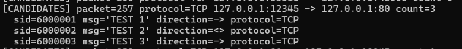

## Test Case 6 

> Header của rule không match với packet sẽ không được đưa vào candidate rules 

Tương tự như test case 6, để test tính năng này thì em sẽ thêm các lệnh in thông tin packet và in các candidate rules tương ứng với nó trong `capture.py` như sau: 

```python
    candidate_rules = repository.candidates(packet_context)

    print(
        f"[CANDIDATES] packet={packet_context.number} "
        f"protocol={packet_context.protocol} "
        f"{packet_context.src_ip}:{packet_context.src_port} -> "
        f"{packet_context.dst_ip}:{packet_context.dst_port} "
        f"count={len(candidate_rules)}"
    )

    for candidate in candidate_rules:
        print(
            f"  sid={candidate.sid} "
            f"msg={candidate.msg!r} "
            f"direction={candidate.direction} "
            f"protocol={candidate.protocol}"
        )
```

Để test tính năng này, em thực hiện như sau: 
- Sử dụng file `test7.rules` có nội dung như sau: 
```
# TEST 1
alert tcp 127.0.0.1 12345 -> 127.0.0.1 80 (msg:"TEST 1"; sid:6000001; rev:1;)

# TEST 2
alert tcp 127.0.0.1 12345 <> 127.0.0.1 80 (msg:"TEST 2"; sid:6000002; rev:1;)

# TEST 3
alert tcp 127.0.0.1 any -> any 80 (msg:"TEST 3"; sid:6000003; rev:1;)

# TEST 4
alert tcp 10.10.10.10 12345 -> 127.0.0.1 80 (msg:"TEST 4"; sid:6000004; rev:1;)

# TEST 5
alert tcp 127.0.0.1 12345 -> 127.0.0.1 443 (msg:"TEST 5"; sid:6000005; rev:1;)

# TEST 6
alert udp 127.0.0.1 12345 -> 127.0.0.1 80 (msg:"TEST 5"; sid:6000005; rev:1;)
```
- Kiểm tra đối với packet tcp `127.0.0.1 12345 -> 127.0.0.1 80`(sử dụng lệnh `nc -p 12345 localhost 80`)

Kết quả: 




=> Kết quả đúng với mong muốn: là 
- Các rule 1, 2, 3 nằm trong candidate rules(vì cùng header(protocol, direction, src ip, src port, dst ip, dst port))
- Ngược lại các rule 4, 5, 6 sẽ không nằm trong candidate rules vì khác header: 
    - rule 4: khác src ip 
    - rule 5: khác dst port 
    - rule 6: khác protocol 
