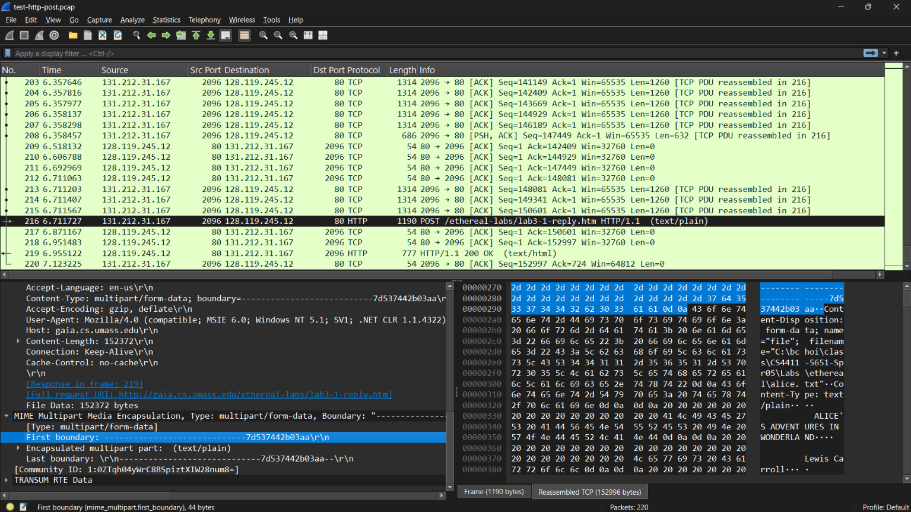

## Kết quả 
Parse thành công body của HTTP POST request 
## Minh chứng 
Ta có ở packet 216 có HTTP POST Reques với body là dữ liệu của một HTTP file upload request sử dụng multipart/form-data


Tương ứng thì em parse thành công body đó 
```json 

{
  "number": "216",
  "sniff_time": "2005-03-05 21:33:11.611647",
  "network": {
    "protocol": "IP",
    "source_ip": "131.212.31.167",
    "dest_ip": "128.119.245.12"
  },
  "transport": {
    "protocol": "tcp",
    "source_port": "2096",
    "dest_port": "80"
  },
  "application": {
    "protocol": "HTTP",
    "headers": {
      "Accept": "image/gif, image/x-xbitmap, image/jpeg, image/pjpeg, application/x-shockwave-flash, application/vnd.ms-excel, application/vnd.ms-powerpoint, application/msword, */*",
      "Referer": "http://gaia.cs.umass.edu/ethereal-labs/TCP-ethereal-file1.html",
      "Accept-Language": "en-us",
      "Content-Type": "multipart/form-data; boundary=---------------------------7d537442b03aa",
      "Accept-Encoding": "gzip, deflate",
      "User-Agent": "Mozilla/4.0 (compatible; MSIE 6.0; Windows NT 5.1; SV1; .NET CLR 1.1.4322)",
      "Host": "gaia.cs.umass.edu",
      "Content-Length": "152372",
      "Connection": "Keep-Alive",
      "Cache-Control": "no-cache"
    },
    "body": "-----------------------------7d537442b03aa Content-Disposition: form-data; name=\"file\"; filename=\"C:\\bchoi\\class\\CS4411-5651-Spr05\\Labs\\ethereal\\alice.txt\" Content-Type: text/plain                  ALICE'S ADVENTURES IN WONDERLAND                            Lewis Carroll                 THE MILLENNIUM F ..."
  }
}

```