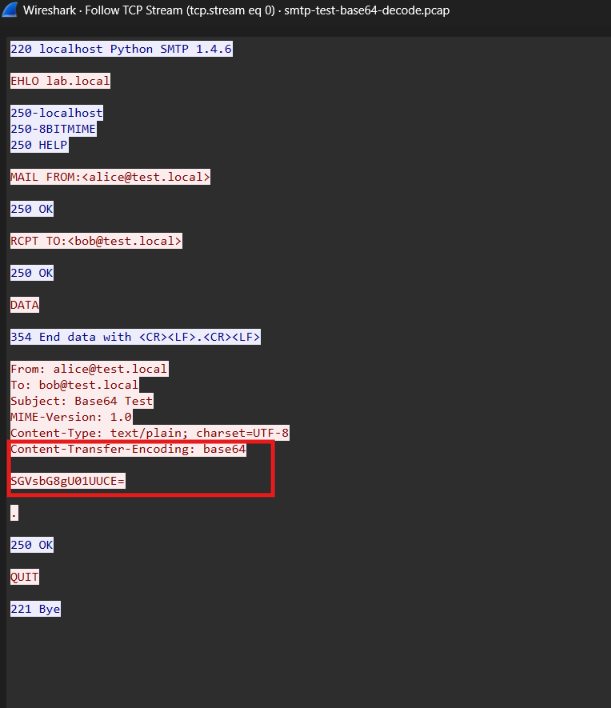

## Kết quả 
Trường `data` chứa dữ liệu đã decode 
## Ví dụ minh chứng 
Trong `smtpt-test-base64-decode.pcap` gửi đi data với Content-Transfer-Encoding: base64, nội dung là encode base64 của chuỗi "Hello SMTP!"


Tương ứng thì kết quả trường `data` là `Hello SMTP!`, đúng với decode base64 của `SGVsbG8gU01UUCE=`
```json 
{"number": "68", "sniff_time": "2026-10-12 22:24:51.106595", "network": {"protocol": "IP", "source_ip": "127.0.0.1", "dest_ip": "127.0.0.1"}, "transport": {"protocol": "tcp", "source_port": "59650", "dest_port": "25"}, "application": {"protocol": "SMTP", "type": "data", "tcp_stream": "0", "imf": {"protocol": "IMF", "fields": {"from": "alice@test.local", "mailbox_list_item": "alice@test.local ", "address": ["alice@test.local ", "bob@test.local "], "to": "bob@test.local", "address_list_item": "bob@test.local ", "subject": "Base64 Test", "mime_version": "1.0", "content_type": "text/plain; charset=UTF-8", "content_type_type": "text/plain", "content_type_parameters": " charset=UTF-8", "content_transfer_encoding": "base64", "data": ["Hello SMTP!"]}}, "data_fragment_count": "9", "data_reassembled_length": "183", "data_fragments": ["36", "40", "44", "48", "52", "56", "58", "62", "64"]}, "flow_id": "flow-000001"}

```