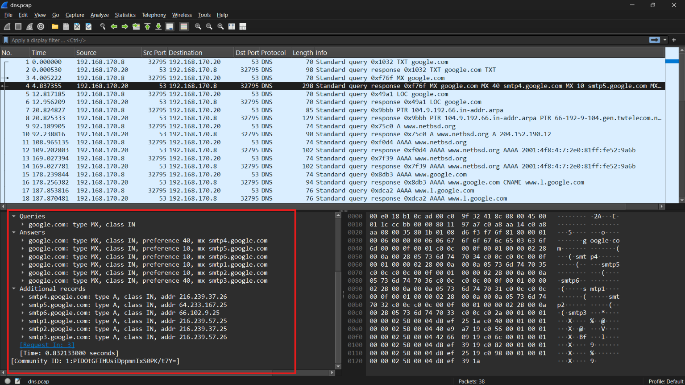

## Kết quả
Đã parse thành công các field trong DNS packet: 
- Header: Flags, số lượng các question, số lượng các resource trong mỗi section(answer, authority, additional)
- Question section: parse các question, có `name` và `type`
- Các resource record trong mỗi section: parse các fields trong record trả về đó, có `name`, `type` và `rdata`

## Ví dụ minh chứng 
Xét packet thứ 4 trong `dns.pcap`, ta thấy đây là một dns response chứa 1 question, 6 answer resources và 6 additional resources 


Tương ứng thì em đã parse thành công 1 question, 6 answer resources và 6 additional resources đó 
```json 

{
  "number": "4",
  "sniff_time": "2005-03-30 15:47:51.333401",
  "network": {
    "protocol": "IP",
    "source_ip": "192.168.170.20",
    "dest_ip": "192.168.170.8"
  },
  "transport": {
    "protocol": "udp",
    "source_port": "53",
    "dest_port": "32795"
  },
  "application": {
    "protocol": "DNS",
    "transaction_id": "0xf76f",
    "flags": "0x8180",
    "opcode": 0,
    "response_code": 0,
    "question_count": 1,
    "answer_count": 6,
    "authority_count": 0,
    "additional_count": 6,
    "type": "response",
    "query": {
      "name": "google.com",
      "type": "MX",
      "type_code": 15,
      "class": "IN",
      "class_code": 1
    },
    "questions": [
      {
        "name": "google.com",
        "type": "MX",
        "type_code": 15,
        "class": "IN",
        "class_code": 1
      }
    ],
    "answers": [
      {
        "name": "google.com",
        "type": "MX",
        "type_code": 15,
        "class": "IN",
        "class_code": 1,
        "ttl": 552,
        "rdata_length": 10,
        "rdata": {
          "preference": 40,
          "exchange": "smtp4.google.com"
        },
        "raw_fields": {
          "mx_preference": ["40"],
          "mx_mail_exchange": ["smtp4.google.com"]
        }
      },
      {
        "name": "google.com",
        "type": "MX",
        "type_code": 15,
        "class": "IN",
        "class_code": 1,
        "ttl": 552,
        "rdata_length": 10,
        "rdata": {
          "preference": 10,
          "exchange": "smtp5.google.com"
        },
        "raw_fields": {
          "mx_preference": ["10"],
          "mx_mail_exchange": ["smtp5.google.com"]
        }
      },
      {
        "name": "google.com",
        "type": "MX",
        "type_code": 15,
        "class": "IN",
        "class_code": 1,
        "ttl": 552,
        "rdata_length": 10,
        "rdata": {
          "preference": 10,
          "exchange": "smtp6.google.com"
        },
        "raw_fields": {
          "mx_preference": ["10"],
          "mx_mail_exchange": ["smtp6.google.com"]
        }
      },
      {
        "name": "google.com",
        "type": "MX",
        "type_code": 15,
        "class": "IN",
        "class_code": 1,
        "ttl": 552,
        "rdata_length": 10,
        "rdata": {
          "preference": 10,
          "exchange": "smtp1.google.com"
        },
        "raw_fields": {
          "mx_preference": ["10"],
          "mx_mail_exchange": ["smtp1.google.com"]
        }
      },
      {
        "name": "google.com",
        "type": "MX",
        "type_code": 15,
        "class": "IN",
        "class_code": 1,
        "ttl": 552,
        "rdata_length": 10,
        "rdata": {
          "preference": 10,
          "exchange": "smtp2.google.com"
        },
        "raw_fields": {
          "mx_preference": ["10"],
          "mx_mail_exchange": ["smtp2.google.com"]
        }
      },
      {
        "name": "google.com",
        "type": "MX",
        "type_code": 15,
        "class": "IN",
        "class_code": 1,
        "ttl": 552,
        "rdata_length": 10,
        "rdata": {
          "preference": 40,
          "exchange": "smtp3.google.com"
        },
        "raw_fields": {
          "mx_preference": ["40"],
          "mx_mail_exchange": ["smtp3.google.com"]
        }
      }
    ],
    "authorities": [],
    "additionals": [
      {
        "name": "smtp4.google.com",
        "type": "A",
        "type_code": 1,
        "class": "IN",
        "class_code": 1,
        "ttl": 600,
        "rdata_length": 4,
        "rdata": {
          "address": "216.239.37.26"
        },
        "raw_fields": {
          "a": ["216.239.37.26"]
        }
      },
      {
        "name": "smtp5.google.com",
        "type": "A",
        "type_code": 1,
        "class": "IN",
        "class_code": 1,
        "ttl": 600,
        "rdata_length": 4,
        "rdata": {
          "address": "64.233.167.25"
        },
        "raw_fields": {
          "a": ["64.233.167.25"]
        }
      },
      {
        "name": "smtp6.google.com",
        "type": "A",
        "type_code": 1,
        "class": "IN",
        "class_code": 1,
        "ttl": 600,
        "rdata_length": 4,
        "rdata": {
          "address": "66.102.9.25"
        },
        "raw_fields": {
          "a": ["66.102.9.25"]
        }
      },
      {
        "name": "smtp1.google.com",
        "type": "A",
        "type_code": 1,
        "class": "IN",
        "class_code": 1,
        "ttl": 600,
        "rdata_length": 4,
        "rdata": {
          "address": "216.239.57.25"
        },
        "raw_fields": {
          "a": ["216.239.57.25"]
        }
      },
      {
        "name": "smtp2.google.com",
        "type": "A",
        "type_code": 1,
        "class": "IN",
        "class_code": 1,
        "ttl": 600,
        "rdata_length": 4,
        "rdata": {
          "address": "216.239.37.25"
        },
        "raw_fields": {
          "a": ["216.239.37.25"]
        }
      },
      {
        "name": "smtp3.google.com",
        "type": "A",
        "type_code": 1,
        "class": "IN",
        "class_code": 1,
        "ttl": 600,
        "rdata_length": 4,
        "rdata": {
          "address": "216.239.57.26"
        },
        "raw_fields": {
          "a": ["216.239.57.26"]
        }
      }
    ],
    "parse_errors": []
  }
}

```

Ví dụ trong wireshark có thấy answer resource đầu tiên là `google.com: type MX, class IN, preference 40, mx smtp4.google.com`
Em parse thành công là: 

```json 
{
"name": "google.com",
"type": "MX",
"type_code": 15,
"class": "IN",
"class_code": 1,
"ttl": 552,
"rdata_length": 10,
"rdata": {
    "preference": 40,
    "exchange": "smtp4.google.com"
},
"raw_fields": {
    "mx_preference": ["40"],
    "mx_mail_exchange": ["smtp4.google.com"]
}
}
```