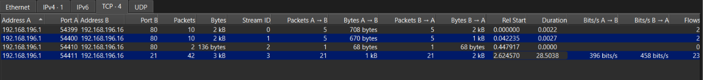
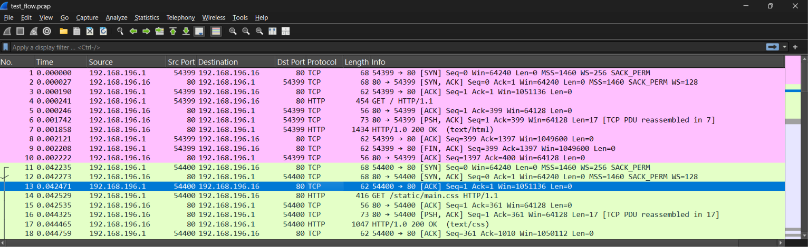
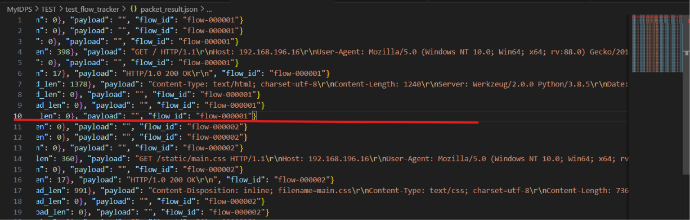
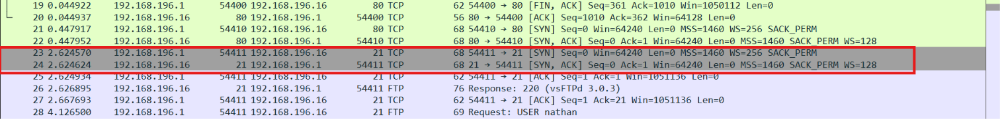
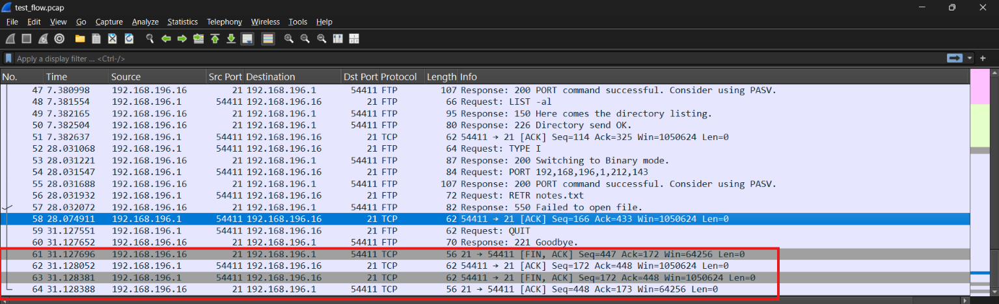
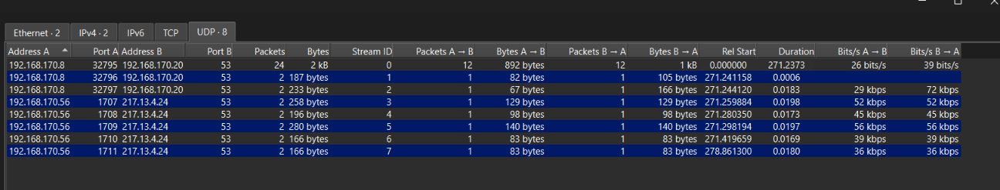

## Kết quả 
Thực hiện thành công các yêu cầu: 
- Nhóm các flow chính xác 
- Thông kê chính xác trên mỗi flow: 
    - State hiện tại (đối với TCP)
    - SYN count, ACK count, FIN count, RST count(đối với TCP), duration, packet count, byte count ở mỗi chiều 
## Minh chứng test cases
### 1. Nhóm các flow chính xác
Trong `test_tcp_flow.pcap` có 4 flows 


Tương ứng thì flow tracker của em cũng track thành công 4 flows với các endpoint tương ứng, các flow không gộp nhầm với nhau 
```json 
{"flow_id": "flow-000001", "protocol": "TCP", "tcp_stream": "0", "endpoint_a": {"ip": "192.168.196.1", "port": 54399}, "endpoint_b": {"ip": "192.168.196.16", "port": 80}, "start_time": "2021-05-14T20:12:49.958142", "last_seen": "2021-05-14T20:12:49.960364", "duration": 0.002222, "directions": {"a_to_b": {"start_time": "2021-05-14T20:12:49.958142", "last_seen": "2021-05-14T20:12:49.960350", "duration": 0.002208, "packet_count": 5, "byte_count": 708, "syn_count": 1, "ack_count": 4, "fin_count": 1, "rst_count": 0}, "b_to_a": {"start_time": "2021-05-14T20:12:49.958169", "last_seen": "2021-05-14T20:12:49.960364", "duration": 0.002195, "packet_count": 5, "byte_count": 1687, "syn_count": 1, "ack_count": 5, "fin_count": 1, "rst_count": 0}}, "stage": "closed"}
--- 
{"flow_id": "flow-000002", "protocol": "TCP", "tcp_stream": "1", "endpoint_a": {"ip": "192.168.196.1", "port": 54400}, "endpoint_b": {"ip": "192.168.196.16", "port": 80}, "start_time": "2021-05-14T20:12:50.000377", "last_seen": "2021-05-14T20:12:50.003079", "duration": 0.002702, "directions": {"a_to_b": {"start_time": "2021-05-14T20:12:50.000377", "last_seen": "2021-05-14T20:12:50.003064", "duration": 0.002687, "packet_count": 5, "byte_count": 670, "syn_count": 1, "ack_count": 4, "fin_count": 1, "rst_count": 0}, "b_to_a": {"start_time": "2021-05-14T20:12:50.000415", "last_seen": "2021-05-14T20:12:50.003079", "duration": 0.002664, "packet_count": 5, "byte_count": 1300, "syn_count": 1, "ack_count": 5, "fin_count": 1, "rst_count": 0}}, "stage": "closed"}
---
{"flow_id": "flow-000003", "protocol": "TCP", "tcp_stream": "2", "endpoint_a": {"ip": "192.168.196.1", "port": 54410}, "endpoint_b": {"ip": "192.168.196.16", "port": 80}, "start_time": "2021-05-14T20:12:50.406059", "last_seen": "2021-05-14T20:12:50.406094", "duration": 3.5e-05, "directions": {"a_to_b": {"start_time": "2021-05-14T20:12:50.406059", "last_seen": "2021-05-14T20:12:50.406059", "duration": 0.0, "packet_count": 1, "byte_count": 68, "syn_count": 1, "ack_count": 0, "fin_count": 0, "rst_count": 0}, "b_to_a": {"start_time": "2021-05-14T20:12:50.406094", "last_seen": "2021-05-14T20:12:50.406094", "duration": 0.0, "packet_count": 1, "byte_count": 68, "syn_count": 1, "ack_count": 1, "fin_count": 0, "rst_count": 0}}, "stage": "handshake"}
---
{"flow_id": "flow-000004", "protocol": "TCP", "tcp_stream": "3", "endpoint_a": {"ip": "192.168.196.1", "port": 54411}, "endpoint_b": {"ip": "192.168.196.16", "port": 21}, "start_time": "2021-05-14T20:12:52.582712", "last_seen": "2021-05-14T20:13:21.086530", "duration": 28.503818, "directions": {"a_to_b": {"start_time": "2021-05-14T20:12:52.582712", "last_seen": "2021-05-14T20:13:21.086523", "duration": 28.503811, "packet_count": 21, "byte_count": 1413, "syn_count": 1, "ack_count": 20, "fin_count": 1, "rst_count": 0}, "b_to_a": {"start_time": "2021-05-14T20:12:52.582766", "last_seen": "2021-05-14T20:13:21.086530", "duration": 28.503764, "packet_count": 21, "byte_count": 1634, "syn_count": 1, "ack_count": 21, "fin_count": 1, "rst_count": 0}}, "stage": "closed"}
```
### 2. Bidirectional flow 
Nhận thấy trong `test_tcp_flow.pcap`, các packet từ 1 đến 10 cùng flow


Tương ứng thì các packet từ 1 đến 10 trong `packet_result.json` cũng có cùng flow id là `flow-000001`, packet 11 có flow id là `flow-000002`

### 3. TCP handshake
Trong `test_tcp_flow.pcap`, ta thấy flow thứ 3 chỉ có 2 packet là SYN và SYN-ACK, tức đang trong quá trình bắt tay 
 

Tương ứng thì trong `flow_result.json`, stage của flow thứ 3 là `handshake`
```json
{"flow_id": "flow-000003", "protocol": "TCP", "tcp_stream": "2", "endpoint_a": {"ip": "192.168.196.1", "port": 54410}, "endpoint_b": {"ip": "192.168.196.16", "port": 80}, "start_time": "2021-05-14T20:12:50.406059", "last_seen": "2021-05-14T20:12:50.406094", "duration": 3.5e-05, "directions": {"a_to_b": {"start_time": "2021-05-14T20:12:50.406059", "last_seen": "2021-05-14T20:12:50.406059", "duration": 0.0, "packet_count": 1, "byte_count": 68, "syn_count": 1, "ack_count": 0, "fin_count": 0, "rst_count": 0}, "b_to_a": {"start_time": "2021-05-14T20:12:50.406094", "last_seen": "2021-05-14T20:12:50.406094", "duration": 0.0, "packet_count": 1, "byte_count": 68, "syn_count": 1, "ack_count": 1, "fin_count": 0, "rst_count": 0}}, "stage": "handshake"}
```
### 4. TCP close 
Trong `test_tcp_flow.pcap`, ở flow thứ 4, ta thấy quá trình close được thực hiện 


Tương ứng thì trong `flow_result.json`, stage của flow thứ 4 là `closed`
```json 
{"flow_id": "flow-000004", "protocol": "TCP", "tcp_stream": "3", "endpoint_a": {"ip": "192.168.196.1", "port": 54411}, "endpoint_b": {"ip": "192.168.196.16", "port": 21}, "start_time": "2021-05-14T20:12:52.582712", "last_seen": "2021-05-14T20:13:21.086530", "duration": 28.503818, "directions": {"a_to_b": {"start_time": "2021-05-14T20:12:52.582712", "last_seen": "2021-05-14T20:13:21.086523", "duration": 28.503811, "packet_count": 21, "byte_count": 1413, "syn_count": 1, "ack_count": 20, "fin_count": 1, "rst_count": 0}, "b_to_a": {"start_time": "2021-05-14T20:12:52.582766", "last_seen": "2021-05-14T20:13:21.086530", "duration": 28.503764, "packet_count": 21, "byte_count": 1634, "syn_count": 1, "ack_count": 21, "fin_count": 1, "rst_count": 0}}, "stage": "closed"}
```
### 5. UDP flow 
Hiện em sử dụng thời gian timeout cho udp flow là 60s 
Trong wireshark thì `test_udp_flow.pcap` hiện có 8 flows 


Tuy nhiên, trong kết quả của em thì có 9 flows 
```json 
{"flow_id": "flow-000001", "protocol": "UDP", "endpoint_a": {"ip": "192.168.170.8", "port": 32795}, "endpoint_b": {"ip": "192.168.170.20", "port": 53}, "start_time": "2005-03-30T15:47:46.496046", "last_seen": "2005-03-30T15:48:07.321379", "duration": 20.825333, ...}}
{"flow_id": "flow-000002", "protocol": "UDP", "endpoint_a": {"ip": "192.168.170.8", "port": 32795}, "endpoint_b": {"ip": "192.168.170.20", "port": 53}, "start_time": "2005-03-30T15:49:18.685951", "last_seen": "2005-03-30T15:52:17.733384", "duration": 179.047433, ...}}
{"flow_id": "flow-000003", "protocol": "UDP", "endpoint_a": {"ip": "192.168.170.8", "port": 32796}, "endpoint_b": {"ip": "192.168.170.20", "port": 53}, "start_time": "2005-03-30T15:52:17.737204", "last_seen": "2005-03-30T15:52:17.737792", "duration": 0.000588, ...}}
{"flow_id": "flow-000004", "protocol": "UDP", "endpoint_a": {"ip": "192.168.170.8", "port": 32797}, "endpoint_b": {"ip": "192.168.170.20", "port": 53}, "start_time": "2005-03-30T15:52:17.740166", "last_seen": "2005-03-30T15:52:17.758453", "duration": 0.018287, ...}}
{"flow_id": "flow-000005", "protocol": "UDP", "endpoint_a": {"ip": "192.168.170.56", "port": 1707}, "endpoint_b": {"ip": "217.13.4.24", "port": 53}, "start_time": "2005-03-30T15:52:17.755930", "last_seen": "2005-03-30T15:52:17.775741", ...}}
{"flow_id": "flow-000006", "protocol": "UDP", "endpoint_a": {"ip": "192.168.170.56", "port": 1708}, "endpoint_b": {"ip": "217.13.4.24", "port": 53}, "start_time": "2005-03-30T15:52:17.776396", "last_seen": "2005-03-30T15:52:17.793697", ...}}
{"flow_id": "flow-000007", "protocol": "UDP", "endpoint_a": {"ip": "192.168.170.56", "port": 1709}, "endpoint_b": {"ip": "217.13.4.24", "port": 53}, "start_time": "2005-03-30T15:52:17.794240", "last_seen": "2005-03-30T15:52:17.813924", "duration": 0.019684, ...}}
{"flow_id": "flow-000008", "protocol": "UDP", "endpoint_a": {"ip": "192.168.170.56", "port": 1710}, "endpoint_b": {"ip": "217.13.4.24", "port": 53}, "start_time": "2005-03-30T15:52:17.915705", "last_seen": "2005-03-30T15:52:17.932629", "duration": 0.016924, ...}}
{"flow_id": "flow-000009", "protocol": "UDP", "endpoint_a": {"ip": "192.168.170.56", "port": 1711}, "endpoint_b": {"ip": "217.13.4.24", "port": 53}, "start_time": "2005-03-30T15:52:25.357346", "last_seen": "2005-03-30T15:52:25.375359", "duration": 0.018013, ...}}

```
Nguyên nhân là kết quả của em tách flow đầu tiên trong wireshark thành 2 flow, nhận xét rằng 2 flow đầu tiên của em có cùng cặp endpoints tuy nhiên flow thứ 2 đã quá thời gian timeout so với last seen của flow đầu tiên 
- last seen của flow đầu tiên trong kết quả của em là `2005-03-30T15:48:07.321379`
- start time của flow thứ hai trong kết quả của em là `2005-03-30T15:49:18.685951`

=> đã quá thời gian timeout là 60s, vì thế kết quả của em tách thành 2 flow 

Có lẽ wireshark sử dụng thời gian timeout lớn hơn 

Đồng thời thì cũng nhận thấy được kết quả của em cũng thống kê thành công trên mỗi flow: packet count, byte count, duration, ... 
```json 
{"flow_id": "flow-000001", "protocol": "UDP", "endpoint_a": {"ip": "192.168.170.8", "port": 32795}, "endpoint_b": {"ip": "192.168.170.20", "port": 53}, "start_time": "2005-03-30T15:47:46.496046", "last_seen": "2005-03-30T15:48:07.321379", "duration": 20.825333, "directions": {"a_to_b": {"start_time": "2005-03-30T15:47:46.496046", "last_seen": "2005-03-30T15:48:07.320873", "duration": 20.824827, "packet_count": 4, "byte_count": 295, "syn_count": 0, "ack_count": 0, "fin_count": 0, "rst_count": 0}, "b_to_a": {"start_time": "2005-03-30T15:47:46.496576", "last_seen": "2005-03-30T15:48:07.321379", "duration": 20.824803, "packet_count": 4, "byte_count": 595, "syn_count": 0, "ack_count": 0, "fin_count": 0, "rst_count": 0}}}
{"flow_id": "flow-000002", "protocol": "UDP", "endpoint_a": {"ip": "192.168.170.8", "port": 32795}, "endpoint_b": {"ip": "192.168.170.20", "port": 53}, "start_time": "2005-03-30T15:49:18.685951", "last_seen": "2005-03-30T15:52:17.733384", "duration": 179.047433, "directions": {"a_to_b": {"start_time": "2005-03-30T15:49:18.685951", "last_seen": "2005-03-30T15:52:17.660780", "duration": 178.974829, "packet_count": 8, "byte_count": 597, "syn_count": 0, "ack_count": 0, "fin_count": 0, "rst_count": 0}, "b_to_a": {"start_time": "2005-03-30T15:49:18.734862", "last_seen": "2005-03-30T15:52:17.733384", "duration": 178.998522, "packet_count": 8, "byte_count": 733, "syn_count": 0, "ack_count": 0, "fin_count": 0, "rst_count": 0}}}
{"flow_id": "flow-000003", "protocol": "UDP", "endpoint_a": {"ip": "192.168.170.8", "port": 32796}, "endpoint_b": {"ip": "192.168.170.20", "port": 53}, "start_time": "2005-03-30T15:52:17.737204", "last_seen": "2005-03-30T15:52:17.737792", "duration": 0.000588, "directions": {"a_to_b": {"start_time": "2005-03-30T15:52:17.737204", "last_seen": "2005-03-30T15:52:17.737204", "duration": 0.0, "packet_count": 1, "byte_count": 82, "syn_count": 0, "ack_count": 0, "fin_count": 0, "rst_count": 0}, "b_to_a": {"start_time": "2005-03-30T15:52:17.737792", "last_seen": "2005-03-30T15:52:17.737792", "duration": 0.0, "packet_count": 1, "byte_count": 105, "syn_count": 0, "ack_count": 0, "fin_count": 0, "rst_count": 0}}}
{"flow_id": "flow-000004", "protocol": "UDP", "endpoint_a": {"ip": "192.168.170.8", "port": 32797}, "endpoint_b": {"ip": "192.168.170.20", "port": 53}, "start_time": "2005-03-30T15:52:17.740166", "last_seen": "2005-03-30T15:52:17.758453", "duration": 0.018287, "directions": {"a_to_b": {"start_time": "2005-03-30T15:52:17.740166", "last_seen": "2005-03-30T15:52:17.740166", "duration": 0.0, "packet_count": 1, "byte_count": 67, "syn_count": 0, "ack_count": 0, "fin_count": 0, "rst_count": 0}, "b_to_a": {"start_time": "2005-03-30T15:52:17.758453", "last_seen": "2005-03-30T15:52:17.758453", "duration": 0.0, "packet_count": 1, "byte_count": 166, "syn_count": 0, "ack_count": 0, "fin_count": 0, "rst_count": 0}}}
{"flow_id": "flow-000005", "protocol": "UDP", "endpoint_a": {"ip": "192.168.170.56", "port": 1707}, "endpoint_b": {"ip": "217.13.4.24", "port": 53}, "start_time": "2005-03-30T15:52:17.755930", "last_seen": "2005-03-30T15:52:17.775741", "duration": 0.019811, "directions": {"a_to_b": {"start_time": "2005-03-30T15:52:17.755930", "last_seen": "2005-03-30T15:52:17.755930", "duration": 0.0, "packet_count": 1, "byte_count": 129, "syn_count": 0, "ack_count": 0, "fin_count": 0, "rst_count": 0}, "b_to_a": {"start_time": "2005-03-30T15:52:17.775741", "last_seen": "2005-03-30T15:52:17.775741", "duration": 0.0, "packet_count": 1, "byte_count": 129, "syn_count": 0, "ack_count": 0, "fin_count": 0, "rst_count": 0}}}
{"flow_id": "flow-000006", "protocol": "UDP", "endpoint_a": {"ip": "192.168.170.56", "port": 1708}, "endpoint_b": {"ip": "217.13.4.24", "port": 53}, "start_time": "2005-03-30T15:52:17.776396", "last_seen": "2005-03-30T15:52:17.793697", "duration": 0.017301, "directions": {"a_to_b": {"start_time": "2005-03-30T15:52:17.776396", "last_seen": "2005-03-30T15:52:17.776396", "duration": 0.0, "packet_count": 1, "byte_count": 98, "syn_count": 0, "ack_count": 0, "fin_count": 0, "rst_count": 0}, "b_to_a": {"start_time": "2005-03-30T15:52:17.793697", "last_seen": "2005-03-30T15:52:17.793697", "duration": 0.0, "packet_count": 1, "byte_count": 98, "syn_count": 0, "ack_count": 0, "fin_count": 0, "rst_count": 0}}}
{"flow_id": "flow-000007", "protocol": "UDP", "endpoint_a": {"ip": "192.168.170.56", "port": 1709}, "endpoint_b": {"ip": "217.13.4.24", "port": 53}, "start_time": "2005-03-30T15:52:17.794240", "last_seen": "2005-03-30T15:52:17.813924", "duration": 0.019684, "directions": {"a_to_b": {"start_time": "2005-03-30T15:52:17.794240", "last_seen": "2005-03-30T15:52:17.794240", "duration": 0.0, "packet_count": 1, "byte_count": 140, "syn_count": 0, "ack_count": 0, "fin_count": 0, "rst_count": 0}, "b_to_a": {"start_time": "2005-03-30T15:52:17.813924", "last_seen": "2005-03-30T15:52:17.813924", "duration": 0.0, "packet_count": 1, "byte_count": 140, "syn_count": 0, "ack_count": 0, "fin_count": 0, "rst_count": 0}}}
{"flow_id": "flow-000008", "protocol": "UDP", "endpoint_a": {"ip": "192.168.170.56", "port": 1710}, "endpoint_b": {"ip": "217.13.4.24", "port": 53}, "start_time": "2005-03-30T15:52:17.915705", "last_seen": "2005-03-30T15:52:17.932629", "duration": 0.016924, "directions": {"a_to_b": {"start_time": "2005-03-30T15:52:17.915705", "last_seen": "2005-03-30T15:52:17.915705", "duration": 0.0, "packet_count": 1, "byte_count": 83, "syn_count": 0, "ack_count": 0, "fin_count": 0, "rst_count": 0}, "b_to_a": {"start_time": "2005-03-30T15:52:17.932629", "last_seen": "2005-03-30T15:52:17.932629", "duration": 0.0, "packet_count": 1, "byte_count": 83, "syn_count": 0, "ack_count": 0, "fin_count": 0, "rst_count": 0}}}
{"flow_id": "flow-000009", "protocol": "UDP", "endpoint_a": {"ip": "192.168.170.56", "port": 1711}, "endpoint_b": {"ip": "217.13.4.24", "port": 53}, "start_time": "2005-03-30T15:52:25.357346", "last_seen": "2005-03-30T15:52:25.375359", "duration": 0.018013, "directions": {"a_to_b": {"start_time": "2005-03-30T15:52:25.357346", "last_seen": "2005-03-30T15:52:25.357346", "duration": 0.0, "packet_count": 1, "byte_count": 83, "syn_count": 0, "ack_count": 0, "fin_count": 0, "rst_count": 0}, "b_to_a": {"start_time": "2005-03-30T15:52:25.375359", "last_seen": "2005-03-30T15:52:25.375359", "duration": 0.0, "packet_count": 1, "byte_count": 83, "syn_count": 0, "ack_count": 0, "fin_count": 0, "rst_count": 0}}}

```