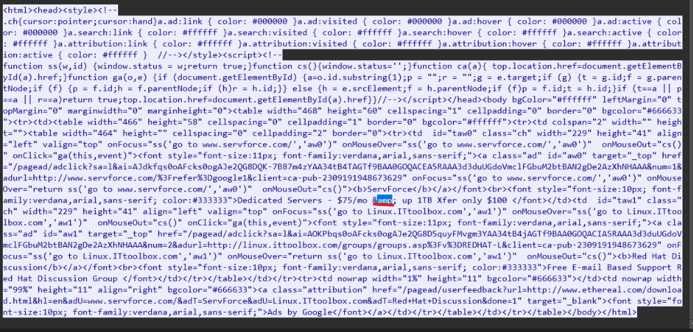

## Giải pháp hiện tại 
Khi thực hiện html entity decode thì một số vẫn đề em thấy là: 
- Nếu decode ngay trong body html của http response trả về thì các HTML entity decode đó và HTML syntax sẽ không được phân biệt với nhau 
- Nếu vẫn giữ nguyên trường `body` chứa các HTML entity encode, đồng thời thêm một trường `decoded_text` có giá trị là toàn bộ html body với các HTML entity decode thì lượng log sẽ tăng lên lớn 

-> Giải pháp hiện tại của em để thực hiện yêu cầu của bt2 này là chỉ thêm trường này đối với các body html response có chứa html entity thôi 
Phương pháp em nghĩ hợp lý hơn là không cần phải thực hiện xử lý và log HTML entity decode 

## Kết quả 
Decode thành công html entity 
## Ví dụ minh chứng 
Packet thứ 27 của `test_html_entity_decode.pcap` có chứa html entity `&amp`


Tương ứng thì trong `application_result.json` trả về đã decode `&amp` thành `&`
```
Dedicated Servers - $75/mo & up 1TB Xfer only $100
```