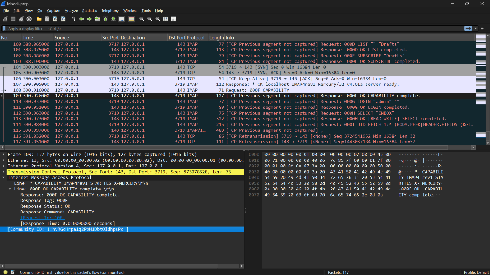

## Kết quả 
Đối với những application khác http, dns, stmp và Pyshark detect được có là protocol gì thì sẽ xuất ra layer của những application protocol đó, field protocol là protocol mà Pyshark detect được, không đánh giá là unknown 
## Minh chứng 
Trong `Mixed1.pcap` có packet IMAP sau:

Tương ứng thì parser của em cũng đã detect được nó là IMAP cũng như parse các layer tương ứng 
```json
{
  "number": "109",
  "sniff_time": "2005-07-17 11:31:18.122000",
  "network": {
    "protocol": "IP",
    "source_ip": "127.0.0.1",
    "dest_ip": "127.0.0.1"
  },
  "transport": {
    "protocol": "tcp",
    "source_port": "143",
    "dest_port": "3719"
  },
  "application": {
    "protocol": "IMAP",
    "fields": {
      "isrequest": "0",
      "line": [
        "* CAPABILITY IMAP4rev1 STARTTLS X-MERCURY ",
        "000F OK CAPABILITY complete. "
      ],
      "response": "000F OK CAPABILITY complete.",
      "response_tag": "000F",
      "tag": "000F",
      "response_status": "OK",
      "response_command": "CAPABILITY",
      "command": "CAPABILITY",
      "response_to": "108",
      "time": "0.010000000"
    }
  }
}


```