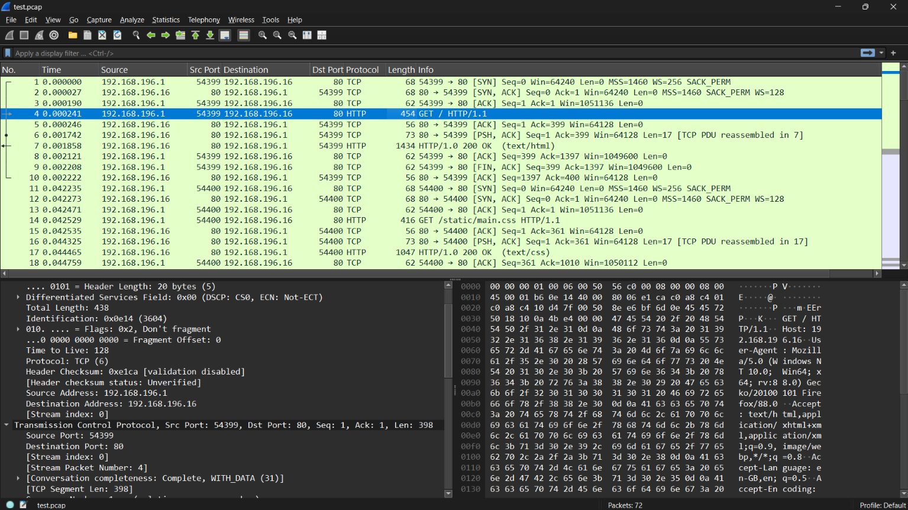

##  Kết quả 
Chương trình parse đúng các fields trong một packets(ip headers, transport headers, payload)
## Minh chứng ví dụ 
### Input 

### Output 
```json

{
  "number": "4",
  "sniff_time": "2021-05-14 20:12:49.958383",
  "network": {
    "version": 4,
    "src_ip": "192.168.196.1",
    "dst_ip": "192.168.196.16",
    "ttl": "128",
    "protocol": "6",
    "length": "438",
    "id": "0x0e14",
    "flags": "0x40",
    "fragment_offset": "0"
  },
  "transport": {
    "protocol": "TCP",
    "src_port": 54399,
    "dst_port": 80,
    "seq": 1,
    "ack": 1,
    "flags": "0x0018",
    "window_size": 4106,
    "payload_len": 398
  },
  "payload": "GET / HTTP/1.1\r\nHost: 192.168.196.16\r\nUser-Agent: Mozilla/5.0 (Windows NT 10.0; Win64; x64; rv:88.0) Gecko/20100101 Firefox/88.0\r\nAccept: text/html,application/xhtml+xml,application/xml;q=0.9,image/webp,*/*;q=0.8\r\nAccept-Language: en-GB,en;q=0.5\r\nAccept-Encoding: gzip, deflate\r\nConnection: keep-alive\r\nUpgrade-Insecure-Requests: 1\r\nDNT: 1\r\nSec-GPC: 1\r\nPragma: no-cache\r\nCache-Control: no-cache\r\n\r\n"
}

```