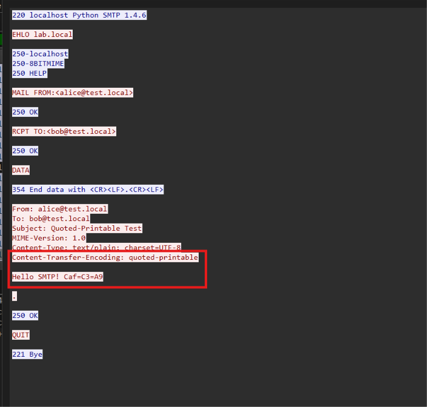

## Kết quả 
Trường `decoded_data` decode qp thành công của `data`
## Ví dụ minh chứng 
Sử dụng data với `Content-Transfer-Encoding: quoted-printable`, `=C3=A9` là encode của `é`


tương ứng thì `"decoded_data": "Hello SMTP! Café\r\n\r\n"` đúng như mong muốn 
```json
{"number": "52", "sniff_time": "2026-10-12 22:31:43.269300", "network": {"protocol": "IP", "source_ip": "127.0.0.1", "dest_ip": "127.0.0.1"}, "transport": {"protocol": "tcp", "source_port": "55366", "dest_port": "25"}, "application": {"protocol": "SMTP", "type": "data", "tcp_stream": "0", "imf": {"protocol": "IMF", "fields": {"from": "alice@test.local", "mailbox_list_item": "alice@test.local ", "address": ["alice@test.local ", "bob@test.local "], "to": "bob@test.local", "address_list_item": "bob@test.local ", "subject": "Quoted-Printable Test", "mime_version": "1.0", "content_type": "text/plain; charset=UTF-8", "content_type_type": "text/plain", "content_type_parameters": " charset=UTF-8", "content_transfer_encoding": "quoted-printable", "data": ["Hello SMTP! Caf=C3=A9\\r\\n", "\\r\\n"], "decoded_data": "Hello SMTP! Café\r\n\r\n"}}, "data_fragment_count": "5", "data_reassembled_length": "208", "data_fragments": ["36", "40", "42", "46", "48"]}, "flow_id": "flow-000001"}
```