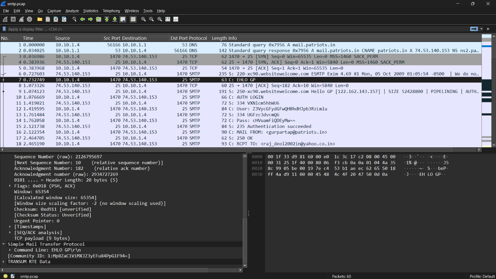
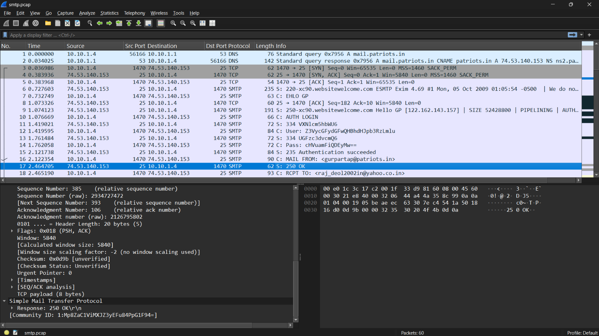
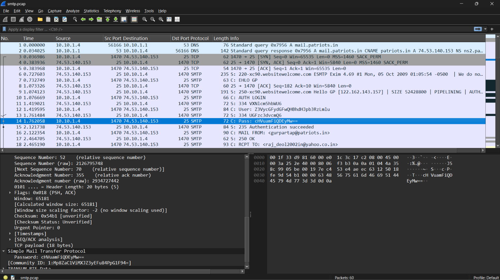
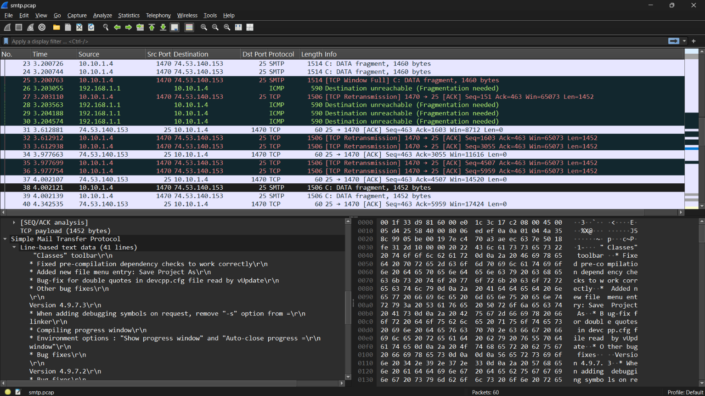

## Kết quả 
Phân loại thành công một SMTP message thành các loại:; 
- request -> request từ client -> parse thành công `command` và `arg`
- response -> response của server -> parse thành công `respone code` và `message`
- auth -> User và Pass -> parse thành công username và password, tuy nhiên không log password  
- data -> nội dung mail -> parse thành công nội dung mail 
## Minh chứng ví dụ: 
### Request
Ở packet thứ 7, ta có một STMP request với command là `EHLO` và arg là `GP`


-> Tương ứng thì ta cũng đã parse thành công command và arg trong SMTP request đó 
```json
{"number": "7", "sniff_time": "2009-10-05 13:06:08.224809", "network": {"protocol": "IP", "source_ip": "10.10.1.4", "dest_ip": "74.53.140.153"}, "transport": {"protocol": "tcp", "source_port": "1470", "dest_port": "25"}, "application": {"protocol": "SMTP", "type": "request", "command": "EHLO", "arg": "GP"}}
``` 
### Response 
Ở packet thứ 17, ta có một SMTP response với response code là `250` và message là `OK`


-> Tương ứng thì ta cũng đã parse thành công response code và message trong SMTP response đó
```json
{"number": "17", "sniff_time": "2009-10-05 13:06:09.956765", "network": {"protocol": "IP", "source_ip": "74.53.140.153", "dest_ip": "10.10.1.4"}, "transport": {"protocol": "tcp", "source_port": "25", "dest_port": "1470"}, "application": {"protocol": "SMTP", "type": "response", "response_code": "250", "message": "OK"}}
``` 
### Auth 
Ở packet thứ 14, ta có một SMTP auth gửi Pass 


-> Tương ứng thì ta cũng đã parse thành công pass trong SMTP auth đó, tuy nhiên không log pass lại mà chỉ đánh dấu là "auth_type": "password" và "auth_password_present": true
```json
{"number": "14", "sniff_time": "2009-10-05 13:06:09.254118", "network": {"protocol": "IP", "source_ip": "10.10.1.4", "dest_ip": "74.53.140.153"}, "transport": {"protocol": "tcp", "source_port": "1470", "dest_port": "25"}, "application": {"protocol": "SMTP", "type": "auth", "auth_type": "password", "auth_password_present": true}}
``` 
### Data 
Ở packet thứ 38 ta có một SMTP data packet với payload là nội dung mai 


-> Tương ứng thì ta cũng đã parse thành công nội dung mail trong SMTP data packet đó 
```json
{"number": "38", "sniff_time": "2009-10-05 13:06:11.494181", "network": {"protocol": "IP", "source_ip": "10.10.1.4", "dest_ip": "74.53.140.153"}, "transport": {"protocol": "tcp", "source_port": "1470", "dest_port": "25"}, "application": {"protocol": "SMTP", "type": "data", "message": " \"Classes\" toolbar\\r\\n* Fixed pre-compilation dependency checks to work correctly\\r\\n* Added new file menu entry: Save Project As\\r\\n* Bug-fix for double quotes in devcpp.cfg file read by vUpdate\\r\\n* Other bug fixes\\r\\n\\r\\nVersion 4.9.7.3\\r\\n* When adding debugging symbols on request, remove \"-s\" option from =\\r\\nlinker\\r\\n* Compiling progress window\\r\\n* Environment options : \"Show progress window\" and \"Auto-close progress =\\r\\nwindow\"\\r\\n* Bug fixes\\r\\n\\r\\nVersion 4.9.7.2\\r\\n* Bug fixes\\r\\n\\r\\nVersion 4.9.7.1\\r\\n* \"Build priority\" per-unit\\r\\n* \"Include file in linking process\" per-unit\\r\\n* New feature: compile current file only\\r\\n* Separated C++ compiler options from C compiler options in Makefile =\\r\\n(see bug report #654744)\\r\\n* Separated C++ include dirs from C include dirs in Makefile (see bug =\\r\\nreport #654744)\\r\\n* Necessary UI changes in Project Options\\r\\n* Added display of project filename, project output and a summary of the =\\r\\nproject files in Project Options General tab.\\r\\n* Fixed the \"compiler-dirs-with-spaces\" bug that crept-in in 4.9.7.0\\r\\n* Multi-select files in project-view (when \"double-click to open\" is =\\r\\nconfigured in Environment Settings)\\r\\n* Resource files are treated as ordinary files now\\r\\n* Updates in \"Project Options/Files\" code\\r\\n* MSVC import now creates the folders structure of the original VC =\\r\\nproject\\r\\n* Bug fixes\\r\\n\\r\\nVersion 4.9.7.0\\r\\n* Allow customizing of per-unit compile command in projects\\r\\n* Added two new macros: <DATE> and <DATETIME>\\r\\n* A"}}

``` 