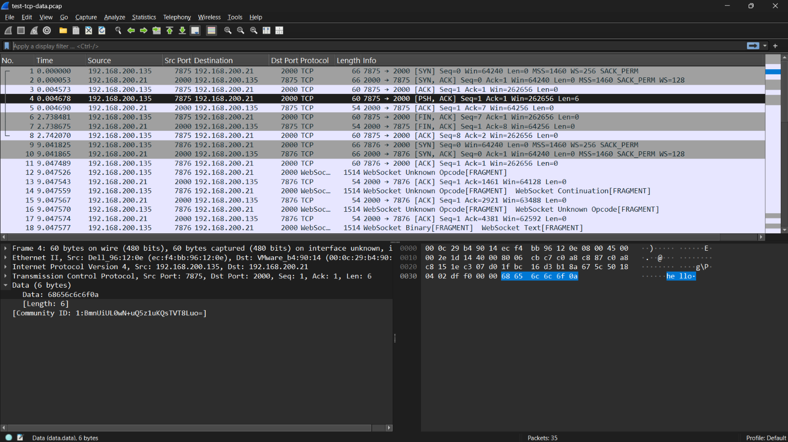

## Kết quả
Parse thành công TCP data  
## Minh chứng ví dụ
Ở packet thứ 4 ta có TCP data là `hello`


Tương ứng thì ta parse thành công application message là `hello\n`
```json
{
  "number": "4",
  "sniff_time": "2020-07-23 09:05:24.239318",
  "network": {
    "protocol": "IP",
    "source_ip": "192.168.200.135",
    "dest_ip": "192.168.200.21"
  },
  "transport": {
    "protocol": "tcp",
    "source_port": "7875",
    "dest_port": "2000"
  },
  "application": {
    "protocol": "UNKNOWN",
    "raw": "hello\n"
  }
}

```