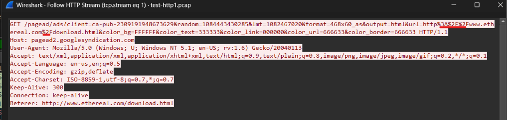

## Kết quả 
Trường `decoded_full_uri` thực hiện url decode thành công từ `full_uri`
## Ví dụ minh chứng 
Packet đầu tiên trong `test_url_decode.pcap` có uri là `/pagead/ads?client=ca-pub-2309191948673629&random=1084443430285&lmt=1082467020&format=468x60_as&output=html&url=http%3A%2F%2Fwww.ethereal.com%2Fdownload.html&color_bg=FFFFFF&color_text=333333&color_link=000000&color_url=666633&color_border=666633 HTTP/1.1` có thực hiện url decode 

Tương ứng thì kết quả trong `application_result.json` của em có trường `decoded_full_uri` là `http://pagead2.googlesyndication.com/pagead/ads?client=ca-pub-2309191948673629&random=1084443430285&lmt=1082467020&format=468x60_as&output=html&url=http://www.ethereal.com/download.html&color_bg=FFFFFF&color_text=333333&color_link=000000&color_url=666633&color_border=666633` -> các ký tự url encode đã được decode tương ứng: 
- `http%3A%2F%2Fwww.ethereal.com%2Fdownload.html` -> `http://www.ethereal.com/download.html`

